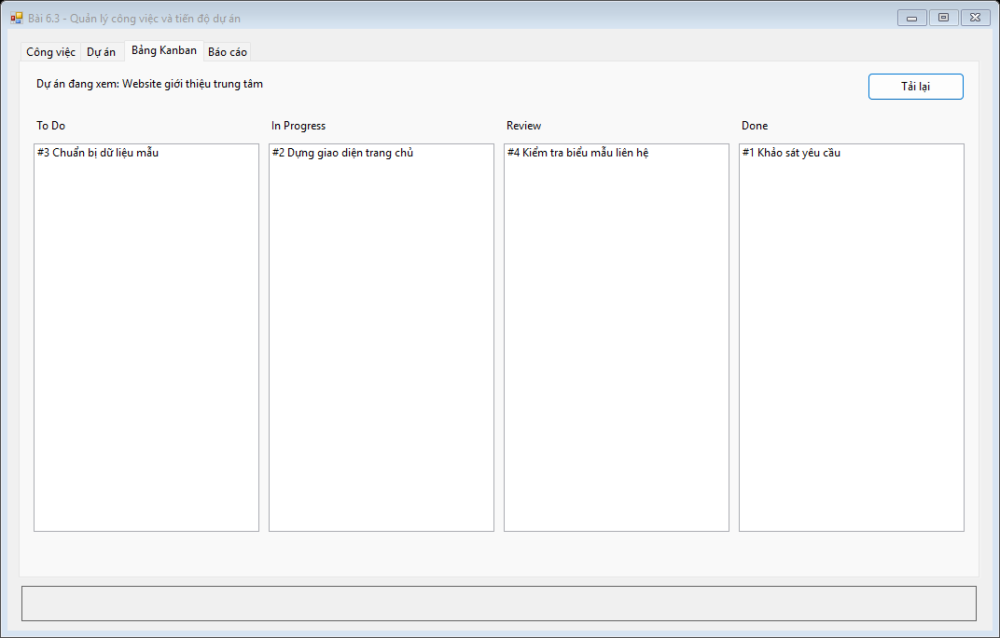
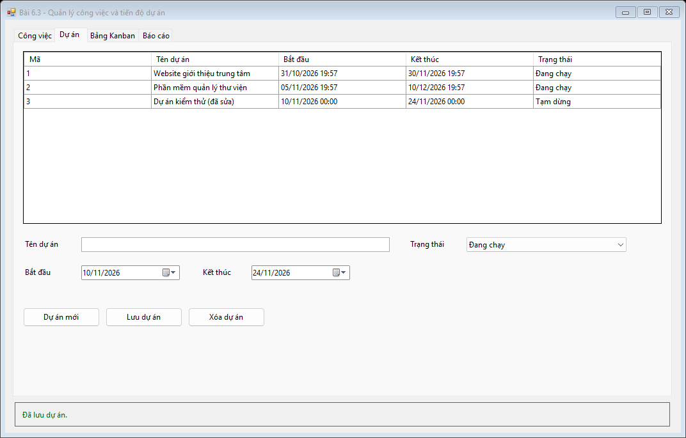
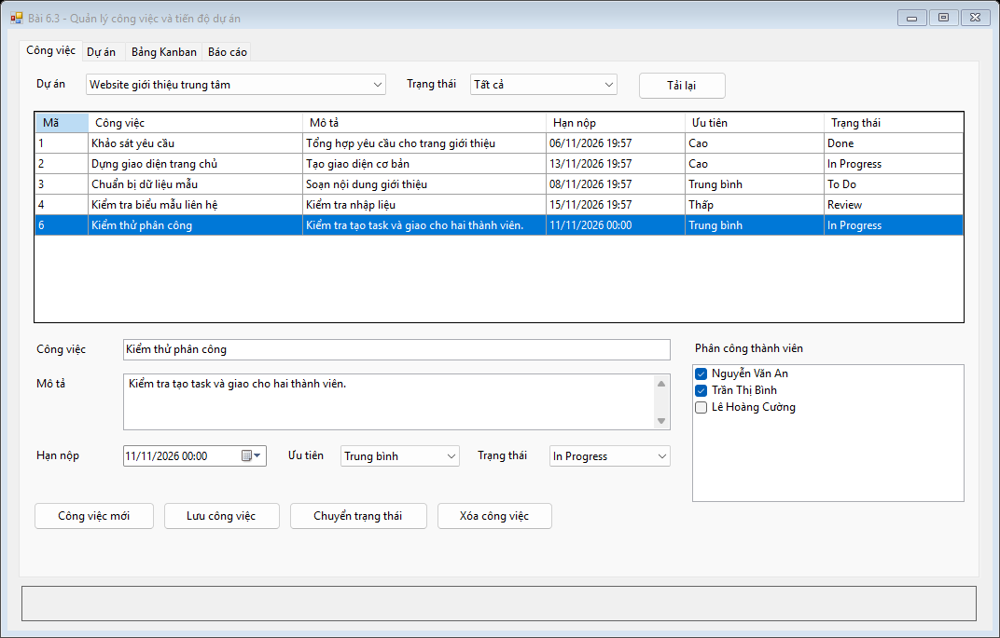
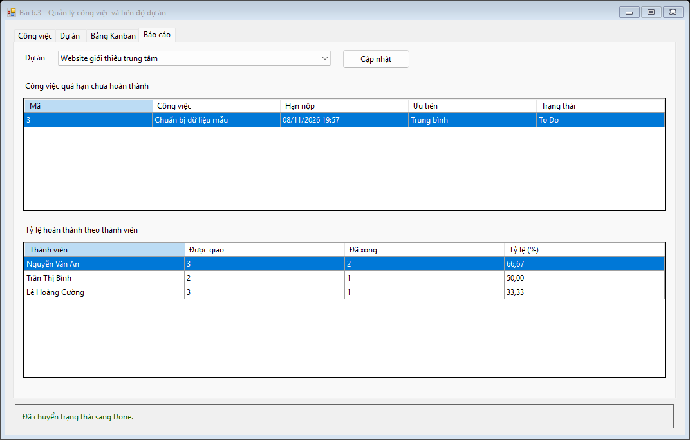
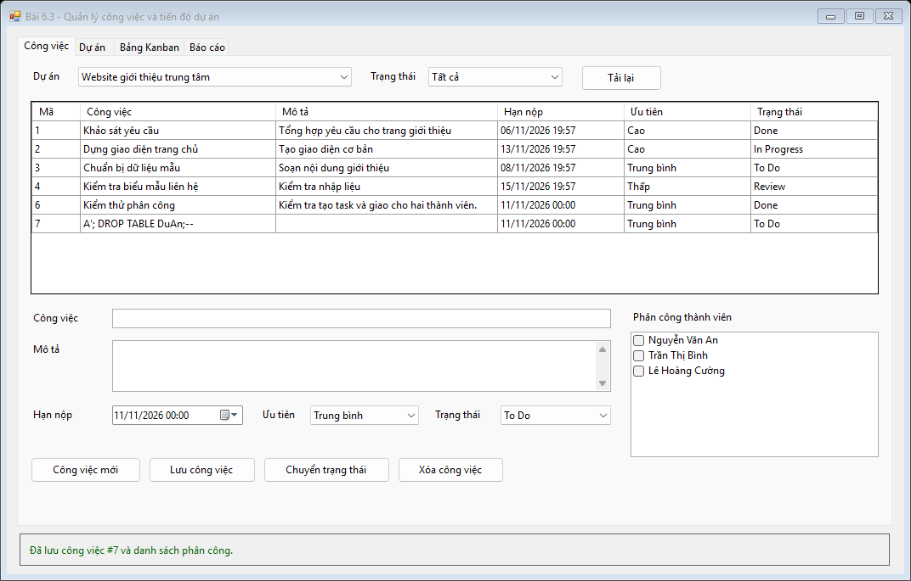

# Bài 6.3 — Quản lý công việc và tiến độ dự án

- Họ và tên: Đoàn Thành Đạt
- Mã sinh viên: 24810320056
- Lớp / Khóa: D19QTANM1

## Chức năng

1. Thêm, sửa, xóa dự án. Nếu dự án còn công việc, form yêu cầu xử lý công việc trước.
2. Chọn dự án, tạo công việc, chọn nhiều thành viên rồi bấm **Lưu công việc**. Mở lại dòng để sửa thông tin hoặc phân công.
3. Lọc danh sách theo dự án và trạng thái. Chọn dòng, đổi trạng thái và bấm **Chuyển trạng thái**. Tab **Bảng Kanban** chia công việc thành To Do, In Progress, Review và Done.
4. Tab **Báo cáo** dùng `SqlDataReader` lấy công việc trễ hạn chưa Done và `GROUP BY` tính phần trăm hoàn thành theo thành viên đã được giao việc.

## Cài đặt và cấu trúc

Chạy [ScriptDB.sql](Database/ScriptDB.sql) để tạo `ProjectTaskDB` và dữ liệu mẫu, mở [ProjectTask.sln](ProjectTask.sln) rồi F5. Chuỗi kết nối nằm trong [App.config](ProjectTask/App.config). Project chia thành [DTO](ProjectTask/DTO), [DAL](ProjectTask/DAL), [BUS](ProjectTask/BUS) và [GUI](ProjectTask/GUI).

## Hình ảnh kết quả

1. Bảng Kanban theo dự án

   

2. Thêm và sửa dự án

   

3. Tạo việc và phân công hai thành viên

   

4. Danh sách trễ hạn và tỷ lệ hoàn thành

   

5. Thử chuỗi giống lệnh SQL trong tên công việc. Chuỗi được lưu như dữ liệu và bảng dự án vẫn còn.

   

## Kiểm tra

[Nhật ký kiểm thử](images/verification.txt) · [Hướng dẫn chạy lại](../README.md#kiểm-tra-tự-động)
