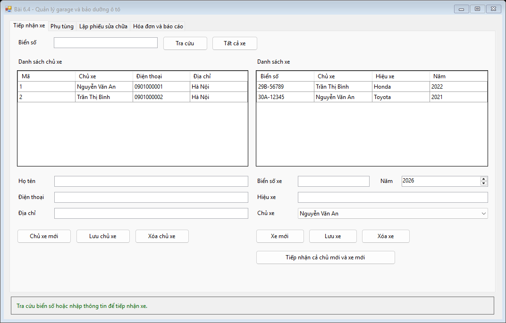
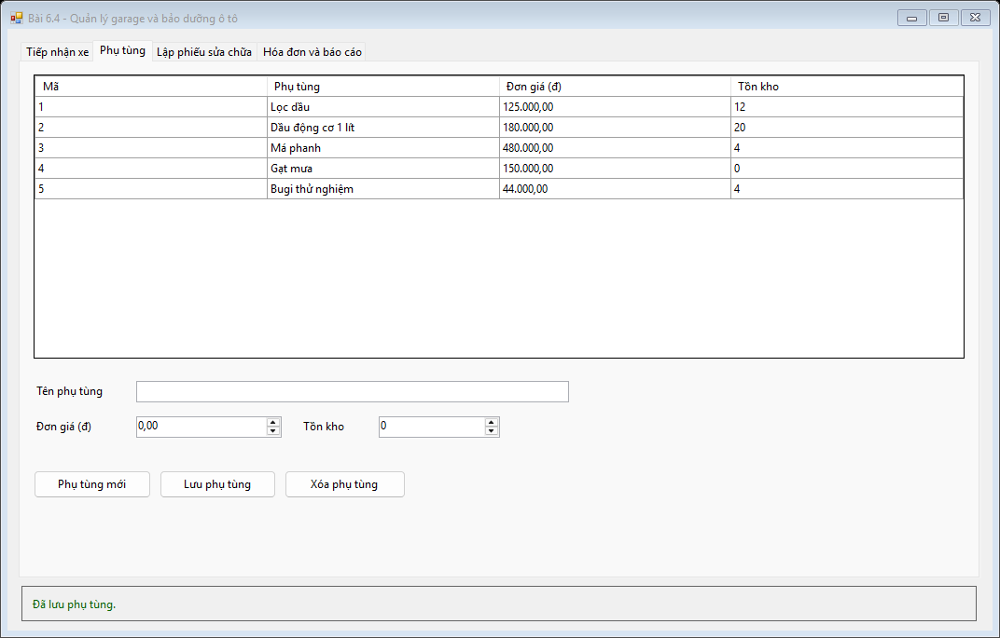
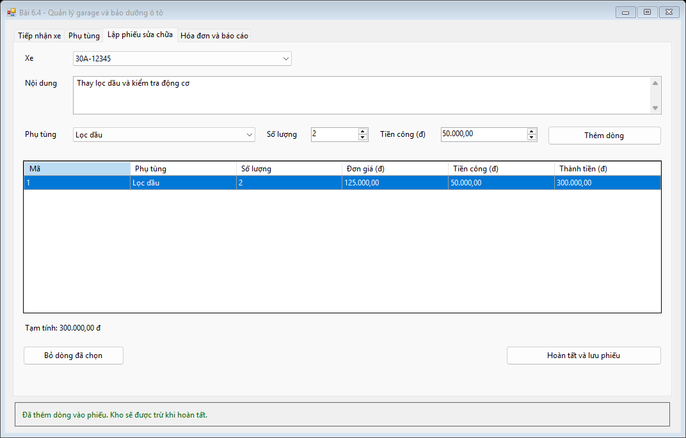
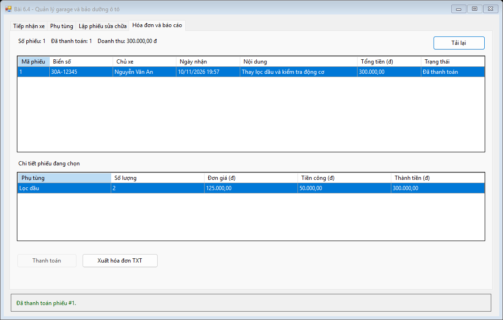
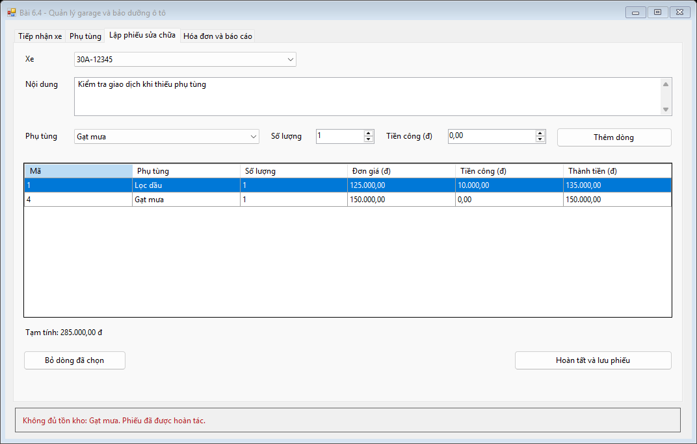

# Bài 6.4 — Quản lý garage và bảo dưỡng ô tô

- Họ và tên: Đoàn Thành Đạt
- Mã sinh viên: 24810320056
- Lớp / Khóa: Chưa cung cấp

## Chức năng

1. Tra cứu biển số bằng `SqlParameter`. Có thể thêm chủ và xe cùng lúc hoặc đăng ký xe cho chủ đã có. Quản lý thông tin chủ xe, xe và phụ tùng.
2. Chọn xe, nhập nội dung sửa, thêm phụ tùng, số lượng và tiền công từng dòng. Bấm **Hoàn tất và lưu phiếu** để tạo phiếu, lưu chi tiết và trừ kho trong một `SqlTransaction`. Nếu thiếu một món, toàn bộ phiếu và phần đã trừ trước đó được hoàn tác.
3. Tính tổng tiền theo số lượng × đơn giá + tiền công từng dòng. Chi tiết lưu thêm đơn giá tại lúc lập phiếu để giữ số tiền khi đổi giá trong danh mục.
4. Tab **Hóa đơn và báo cáo** có danh sách phiếu, chi tiết, tổng doanh thu đã thanh toán và nút xuất hóa đơn TXT sau khi thanh toán.

## Cài đặt và cấu trúc

Chạy [ScriptDB.sql](Database/ScriptDB.sql) để tạo `GarageDB` và dữ liệu mẫu, mở [Garage.sln](Garage.sln) rồi F5. Chuỗi kết nối nằm trong [App.config](Garage/App.config). Project chia thành [DTO](Garage/DTO), [DAL](Garage/DAL), [BUS](Garage/BUS) và [GUI](Garage/GUI).

## Hình ảnh kết quả

1. Tiếp nhận xe

   

2. Danh mục phụ tùng

   

3. Lập phiếu và tính tạm tổng tiền

   

4. Báo cáo và phiếu đã thanh toán

   

5. Hoàn tác phiếu vì phụ tùng gạt mưa không còn hàng

   

## Kiểm tra

[Nhật ký kiểm thử](images/verification.txt) · [Hướng dẫn chạy lại](../README.md#kiểm-tra-tự-động)
