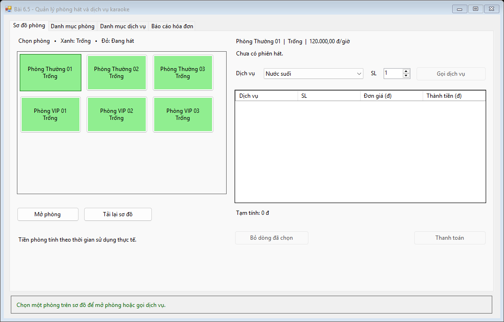
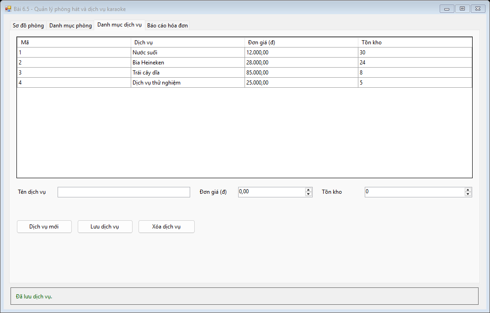
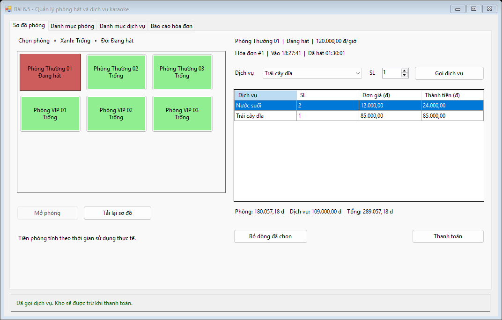
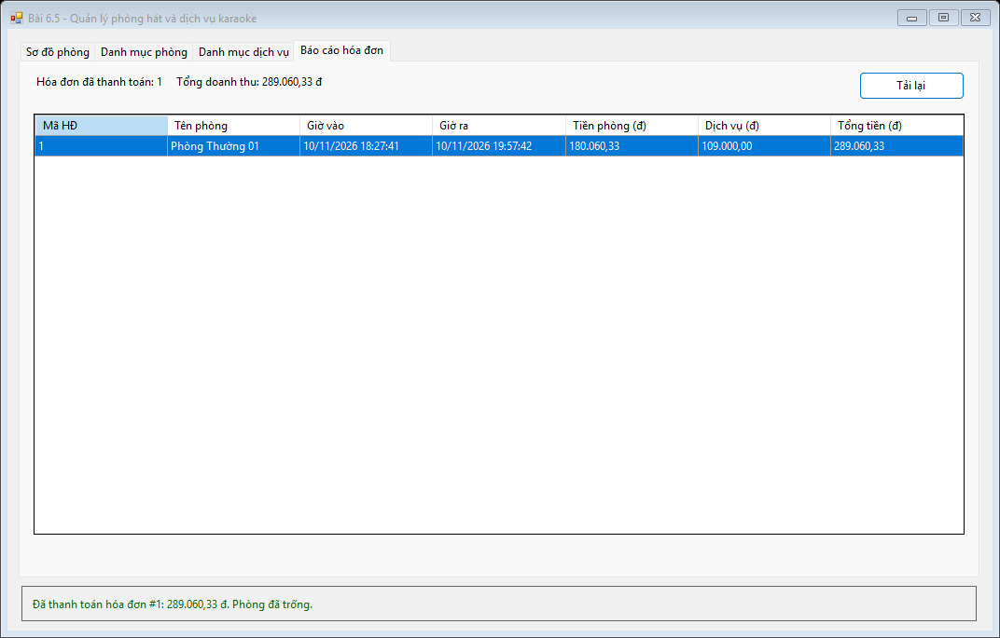
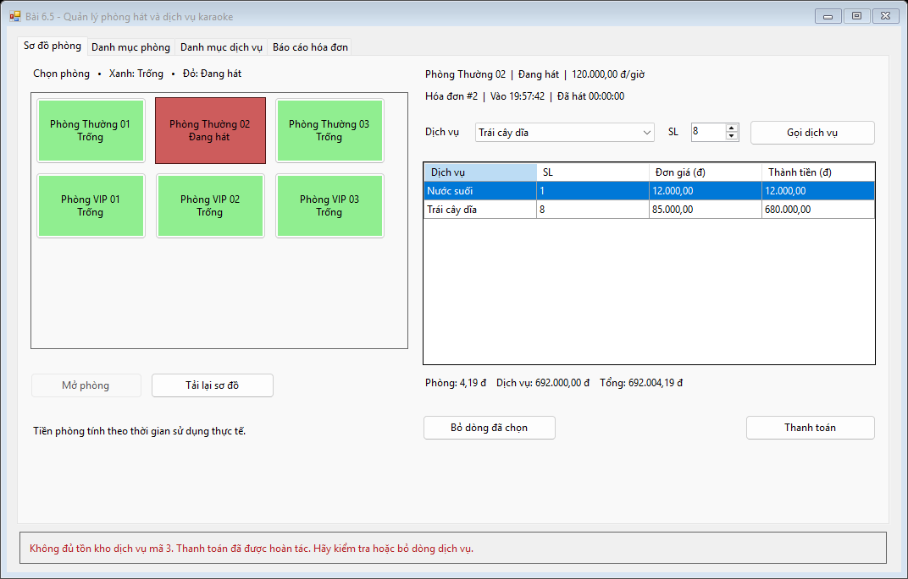

# Bài 6.5 — Quản lý phòng hát và dịch vụ karaoke

- Họ và tên: Đoàn Thành Đạt
- Mã sinh viên: 24810320056
- Lớp / Khóa: D19QTANM1

## Chức năng

1. Sơ đồ hiển thị phòng trống màu xanh và phòng đang hát màu đỏ. **Mở phòng** tạo hóa đơn với giờ vào của SQL Server. Bộ đếm trên form cập nhật theo giây.
2. Chọn phòng đang hát rồi gọi dịch vụ. Danh sách dùng `SqlDataAdapter` nạp `DataTable` lên `DataGridView`. Gọi lại cùng một món sẽ cộng số lượng.
3. Tiền phòng tính theo thời gian sử dụng thực tế nhân giá giờ, làm tròn hai chữ số thập phân. Khi thanh toán, một `SqlTransaction` chốt hóa đơn, trừ kho và trả phòng về trạng thái trống.
4. Có CRUD phòng, dịch vụ và báo cáo doanh thu từ hóa đơn đã thanh toán. Nếu hai phòng gọi cùng một món và kho hết trước lúc thanh toán, có thể bỏ dòng thiếu rồi thử lại.

## Cài đặt và cấu trúc

Chạy [ScriptDB.sql](Database/ScriptDB.sql) để tạo `KaraokeDB` và dữ liệu mẫu, mở [Karaoke.sln](Karaoke.sln) rồi F5. Chuỗi kết nối nằm trong [App.config](Karaoke/App.config). Project chia thành [DTO](Karaoke/DTO), [DAL](Karaoke/DAL), [BUS](Karaoke/BUS) và [GUI](Karaoke/GUI).

## Hình ảnh kết quả

1. Sơ đồ phòng lúc khởi động

   

2. Danh mục dịch vụ

   

3. Gọi dịch vụ và xem tạm tính. Lần kiểm thử này đặt giờ vào lùi 90 phút trong CSDL thử để kiểm tra công thức.

   

4. Báo cáo sau khi thanh toán

   

5. Hoàn tác thanh toán khi thiếu tồn kho, giữ phòng ở trạng thái đang hát

   

## Kiểm tra

[Nhật ký kiểm thử](images/verification.txt) · [Hướng dẫn chạy lại](../README.md#kiểm-tra-tự-động)
