# Bài tập 6.3, 6.4 và 6.5 — Lập trình .NET

- Họ và tên: Đoàn Thành Đạt
- Mã sinh viên: 24810320056
- Lớp / Khóa: Chưa cung cấp

| Bài | Chức năng chính | Báo cáo |
|---|---|---|
| 6.3 | Quản lý dự án, phân công và theo dõi công việc | [ProjectTask](Bai6_3_ProjectTask/README.md) |
| 6.4 | Tiếp nhận xe, lập phiếu sửa chữa và thanh toán | [Garage](Bai6_4_Garage/README.md) |
| 6.5 | Mở phòng karaoke, gọi dịch vụ và tính tiền theo giờ | [Karaoke](Bai6_5_Karaoke/README.md) |

## Hình ảnh kết quả

| Màn hình | Bài 6.3 | Bài 6.4 | Bài 6.5 |
|---|---|---|---|
| Tổng quan | 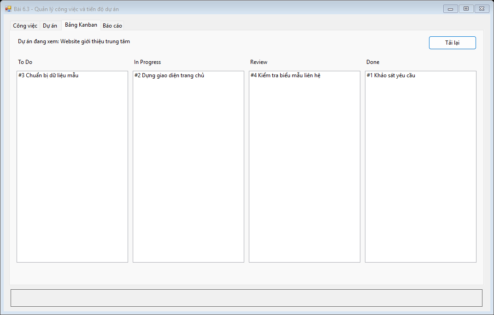 | 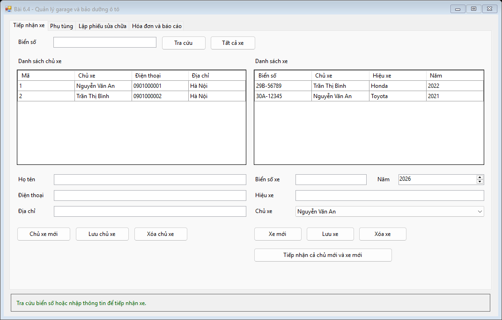 | 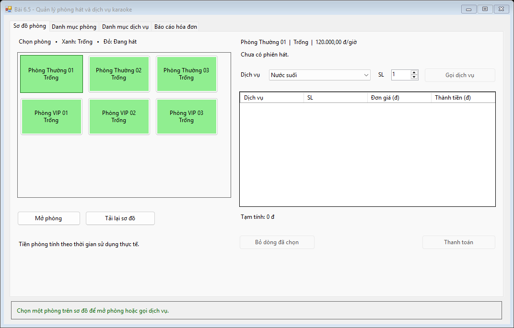 |
| Quản lý danh mục | 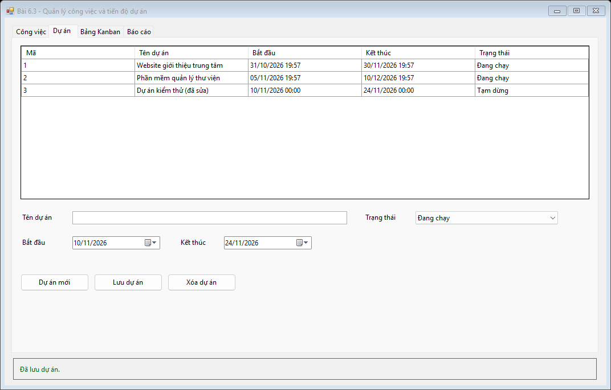 | 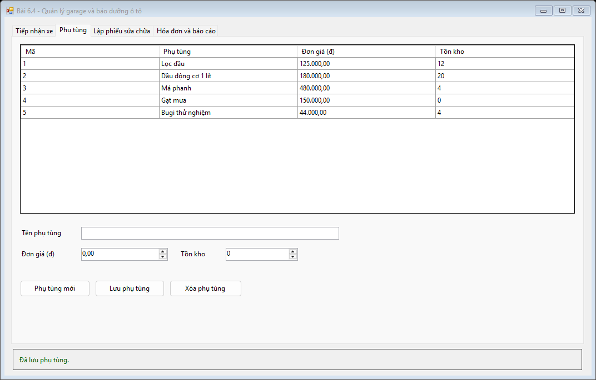 | 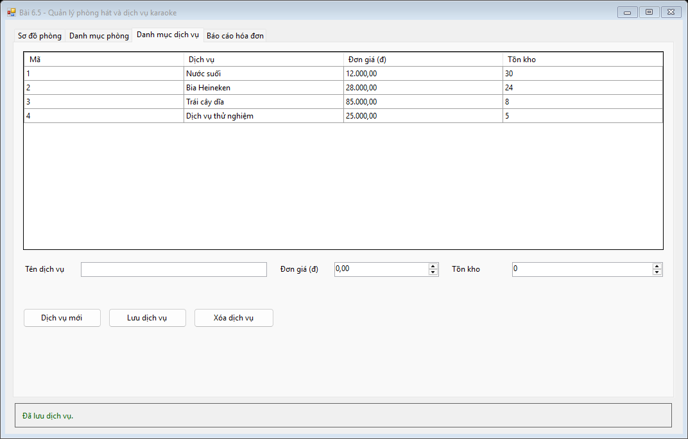 |
| Nghiệp vụ | 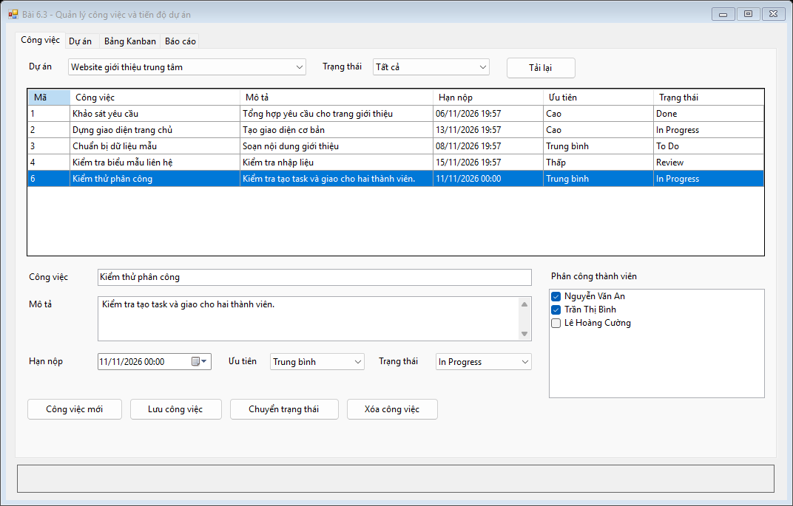 | 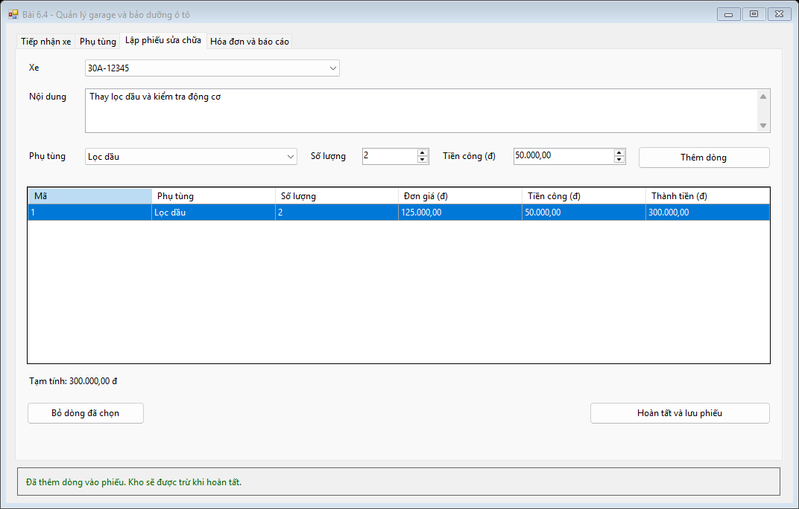 | 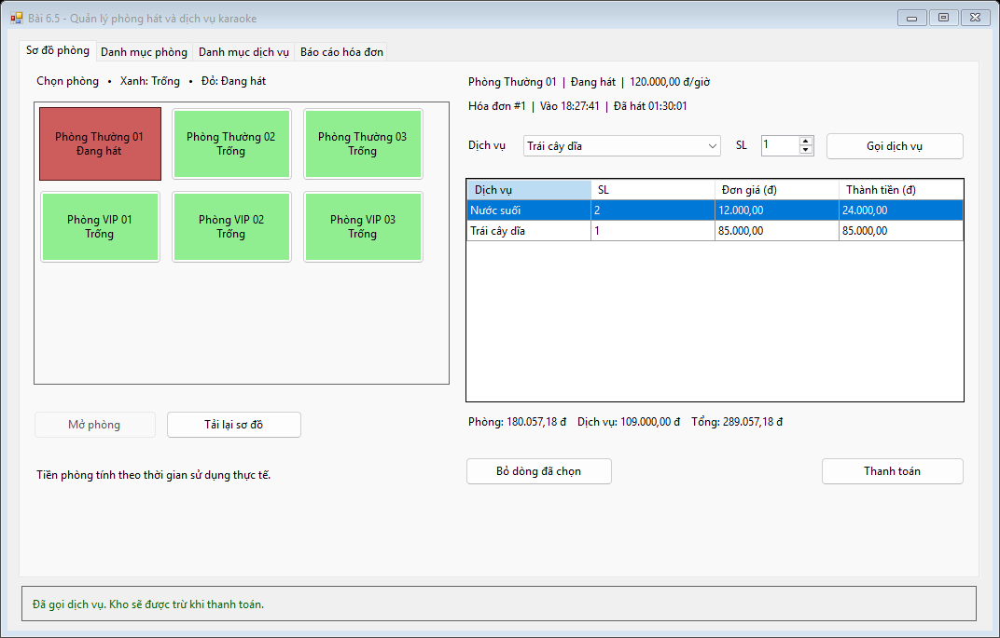 |
| Báo cáo | 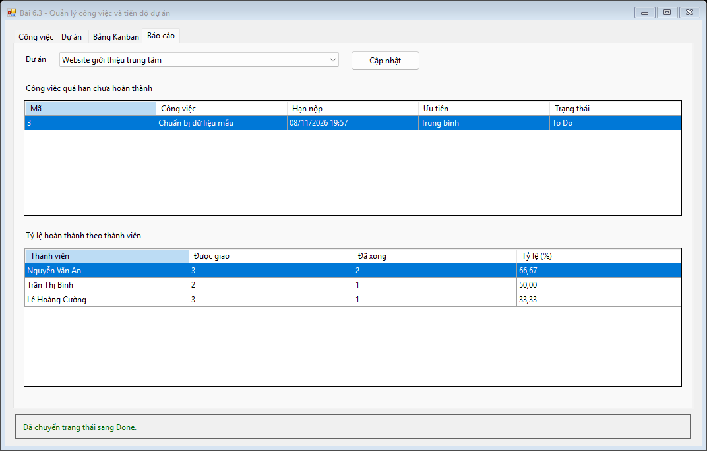 | 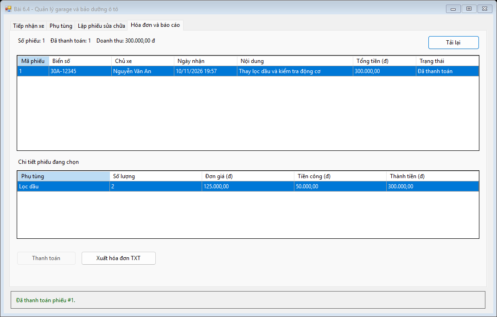 | 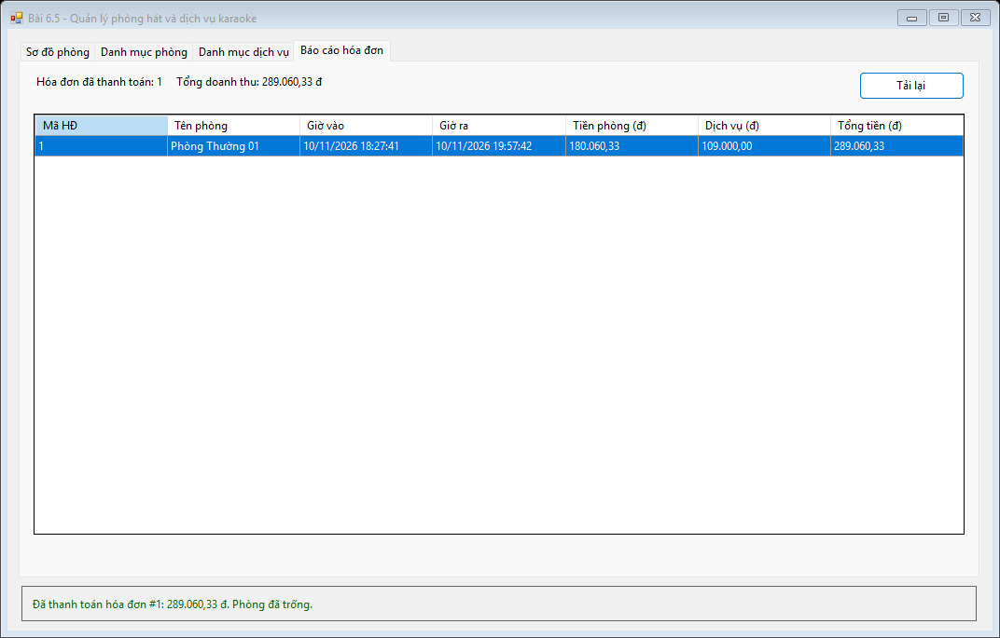 |
| An toàn dữ liệu | 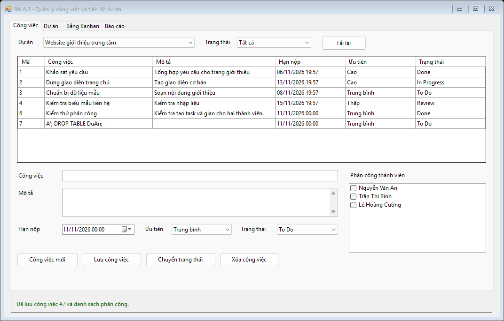 | 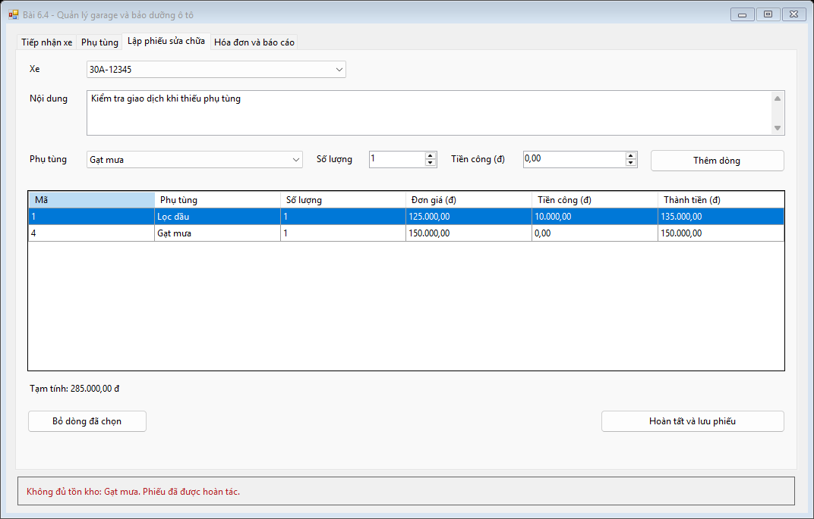 | 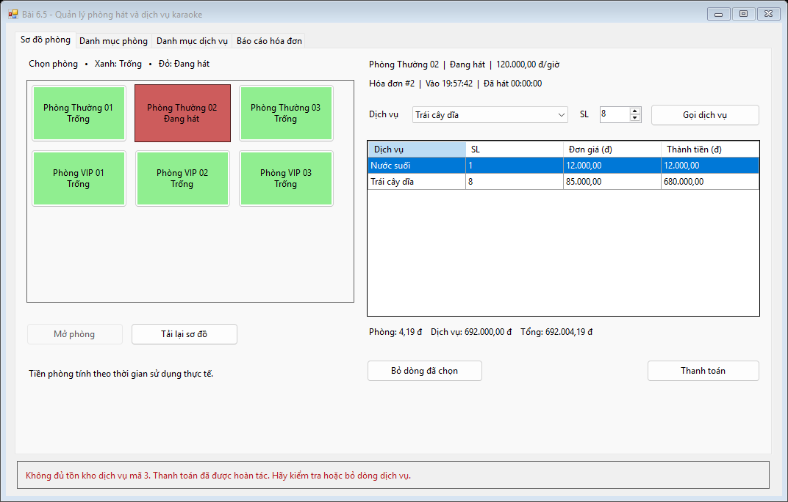 |

## Cách chạy

1. Dùng Windows, Visual Studio với workload **.NET desktop development**, .NET Framework 4.8 Developer Pack và SQL Server hoặc SQL Server LocalDB.
2. Mở SSMS, kết nối `(localdb)\MSSQLLocalDB`, chạy `Database/ScriptDB.sql` trong thư mục bài cần mở.
3. Mở file `.sln` tương ứng và nhấn **F5**. Nếu dùng instance SQL Server khác, sửa `Data Source` trong `App.config` của bài đó.

## Kiểm tra tự động

Mở PowerShell ở thư mục này và chạy:

```powershell
.\Verify.ps1
```

Script build ba solution, chạy script SQL trên các CSDL LocalDB riêng, thao tác trên form, đối chiếu dữ liệu đã lưu và lưu ảnh/log vào `TestOutput`. CSDL kiểm thử được xóa sau mỗi lần chạy.

Kết quả lần kiểm tra cuối trên Windows và SQL Server LocalDB: **44/44 đạt**.

| Bài | Kết quả | Nội dung chính đã kiểm tra |
|---|---|---|
| 6.3 | [14/14](Bai6_3_ProjectTask/images/verification.txt) | CRUD dự án, phân công nhiều người, lọc và chuyển trạng thái, báo cáo trễ hạn, truy vấn có tham số |
| 6.4 | [16/16](Bai6_4_Garage/images/verification.txt) | Tiếp nhận xe, CRUD, lập phiếu và trừ kho, thanh toán, tệp hóa đơn TXT và rollback thiếu phụ tùng |
| 6.5 | [14/14](Bai6_5_Karaoke/images/verification.txt) | Mở phòng, bộ đếm, gọi dịch vụ, tính tiền, thanh toán, rollback và thử lại |
